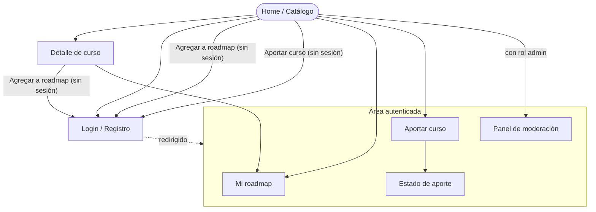

# APPFlow — Mapa del sitio y flujos de usuario — Learnity

## 1. Sitemap

## 2. Rutas

| Ruta | Pantalla | Requiere login | Notas |
|------|----------|----------------|-------|
| `/`, `/catalogo` | Catálogo comunitario (paginado) | no | Muestra el listado de cursos publicados, con barra de búsqueda por título/tema, filtros y paginación. |
| `/catalogo/:id` | Detalle de curso | no | Ficha completa del curso con sus metadatos y botón agregar a mi roadmap |
| `/roadmap` | Mi roadmap | sí | Espacio personal del usuario con sus cursos. Redirect a `/login` si no hay sesión. |
| `/aportar` | Formulario de aporte | sí | Formulario de carga de cursos con metadatos obligatorios y declaración de toma. Redirect a `/login` si no hay sesión. |
| `/aportar/:id/estado` | Estado de mi aporte | sí | Vista de seguimiento para el autor que cargó un curso mostrando el estado actual |
| `/login`, `/registro` | Autenticación | no | Formulario de ingreso o registro con bycrypt y rate limiting en el login. |
| `/validar` | Panel de moderación | sí (rol) | Vista restringida para moderadores donde se aprueban o rechazan los aportes en estado 'pendiente' |

## 3. Fichas de pantalla

### Pantalla: Catálogo comunitario (`/` , `/catalogo`)

- **Objetivo del usuario:** Explorar, buscar y filtrar cursos gratuitos validados de la comunidad.
- **Componentes (de la UX-UI):** header sticky, campo de busqueda outlined, filtros de busqueda, grilla de tarjetas (cards) de curso, paginador centrado, empty state, skeleton
- **Estados:** `loading` (skeleton) · `ok` · `empty` (sin resultados) · `error` (retry)
- **APIs que consume:** `GET /api/v1/cursos?page=…&page_size=…&categoria=…&q=…` y `GET /api/v1/categorias` → ver BackendSchema §3.2
- **Navegación:** ruta principal por defecto; navega hacia Detalle de curso; a Aportar curso; a Panel de  moderación (con rol); a Login; y a Mi roadmap.

### Pantalla: Detalle de curso (`/catalogo/:id`)

- **Objetivo del usuario:** Consultar la información completa de un curso.
- **Componentes (de la UX-UI):** header sticky, ficha central de superficie, chips de categoría y atributos, botón primario "Agregar a mi roadmap" y enlace externo con icono.
- **Estados**: `loading` (skeleton), `ok`, `error`
- **APIs que consume**: `GET /api/v1/cursos/{id}`y `POST /api/v1/roadmap/items` (al agregar al roadmap)
- **Navegación**: Desde Catálogo comunitario; navega hacia Mi roadmap o a Login en caso que no haya sesión activa.

### Pantalla: Mi roadmap (`/roadmap`)

- **Objetivo del usuario**: Visualizar, gestionar y dar seguimiento a los cursos guardado en espacio personal de aprendizaje.
- **Componentes (de la UX-UI)**: header sticky, grilla de cards de cursos con ordenamiento, badges de estado de avance, boton de eliminacion de item y paginador.
- **Estados**: `loading` (skeleton), `ok`, `empty` (vacio), `error`
- **APIs que consume**: `GET /api/v1/roadmap?page=...&page_size=...` y `DELETE /api/v1/roadmap/items/{id}`
- **Navegacion**: Desde el menu/header; hacia Detalle de curso; a Catálogo comunitario; o a Login si no hay sesión activa.

### Pantalla: Formulario de aporte (`/aportar`)

- **Objetivo del usuario**: Cargar un nuevo curso gratuito de cualquier proveedor completando sus metadatos y marcando la declaración de toma.
- **Componentes (de la UX-UI)**: formulario de tarjeta de 1 columna, campos estilo outlined, selector de categoria, checkbox de atributos, selector de declaracion de toma y boton primario "Enviar aporte".
- **Estados**: `default`, `focus`, `error` (validaciones inline), `loading`
- **APIs que consume**:  `GET /api/v1/categorias` y `POST /api/v1/aportes`
- **Navegacion**: Desde el menu/header;  al enviar con exito redirige al estado del aporte; a Login si no hay sesion activa.

### Pantalla: Estado de aporte (`/aportar/:id/estado`)
- **Objetivo del usuario**: Verificar el estado de aprobacion del curso que acaba de enviar.
- **Componentes (de la UX-UI)**: Tarjeta informativa de superficie, badge de estado.
- **Estados**: `ok`, `error`,
- **APIs que consumen**: `GET /api/v1/aportes/{id}`
- **Navegacion**: Desde el flujo de Aportar curso; permite volver al Catálogo comunitario.

### Pantalla: Autenticación (`/login` y `/registro`)
- **Objetivo del usuario**: Iniciar sesion con sus credenciales si ya esta registrado o crear una cuenta para habilitar las funciones de aportes de cursos y roadmap.
- **Componentes (de la UX-UI)**: Tarjeta centrada en pantalla, pestañas para login o registro, campos outlined para email y contraseña, mensaje de error generak y boton primario de accion.
- **Estados**: `default`, `error` `loading` 
- **APIs que consume**: `POST /api/v1/auth/login` o `POST /api/v1/auth/registro`
- **Navegacion**: Desde cualquier intento de accion protegida o desde el header; al autenticarse redirige a la ruta principal o a la ruta que intentaba visitar.

### Pantalla: Panel de moderacion `/validar`
- **Objetivo del usuario**: Permite a los usuarios con rol de Administrador revisar la lista de cursos 'pendiente' para aprobarlos o rechazarlos.
- **Componentes (de la UX-UI)**: Tabla o tarjeta de aportes pendientes, vista previa de metadatos, campo para motivo de rechazao y botones de accion "Aprobar" / "Rechazar".
- **Estados**: `loading`, `ok`, `empty`, `error` 
- **APIs que consume**: `GET /api/v1/aportes` y `POST /api/v1/aportes/{id}/validar`
- **Navegacion**: Desde el enlace en el menu (solo visible con rol "admin"); tras revisar regresa al Catalogo comunitario o permanece en la lista.

## 4. Flujos de usuario (mínimo 3)

> Pasos numerados de punta a punta, incluyendo validaciones, errores y ramas alternativas.

### Flujo 1 — Aportar un curso al catálogo

1. Usuario logueado presiona "Aportar curso" (menú/header)
2. Llega a `/aportar`; el formulario pide: URL activa, categoría (lista), tema, título, versión, año, docentes, flags (cuestionarios / examen / certificado / aval), y la declaración "yo tomé este curso"
3. Validaciones en línea: campos obligatorios completos, formato válido de URL
4. Enviar aporte → `POST /api/v1/aportes` → 201 con estado `pendiente`
5. Toast de confirmación + redirección a "estado de mi aporte"
6. **Rama de error:** validación fallida → mensajes inline, nada se pierde; error de red → toast de error + reintentar

### Flujo 2 — Descubrir un curso y agregarlo a mi roadmap

1. Usuario logueado o visitante explora el catálogo en `/` o `/catalogo` utilizando el campo de busqueda con filtros.
2. Toca una tarjeta de curso para acceder a su detalle en `/catalogo/:id` y visualiza su información.
3. Presiona el boton "Agregar a mi roadmap"
4. Depende si está logueado:
   - Usuario logueado: `POST /api/v1/roadmaps/items` → 201
   - Visitante: Redirige automaticamente a `/login` preservando la ruta de origen `/login?redirect=/catalogo/:id`. Tras iniciar sesión, el usuario es reorientado a `/catalogo/:id` para completar la accion.
5. El usuario navega a `/roadmap` para visualizar su listado personal de cursos.
6. **Rama de error**: curso ya presente → la API notifica que el curso ya esta guardado en el roadmap 

### Flujo 3 — Validación de un aporte (según tu decisión de producto)

1. Un usuario con rol "admin" ingresa a la pantalla principal y selecciona "Panel de moderación" (`/validar`).
2. La app invoca `GET /api/v1/aportes` y renderiza la tabla de cursos en estado 'pendiente'.
3. El administrador elije un aporte, analiza la información y abre el enlace externo en una nueva pestaña.
4. El administrador decide:
    - "Aprobar" → `POST /api/v1/aportes/{id}/validar` con `{ "aprobado": true }`. El backend actualiza el estado a 'aprobado', el curso abandona la cola de moderacion y pasa a estar visible en el catálogo comunitario `/catalogo`.
    - Completar campo de motivo de rechazo y luego "Rechazar" → `POST /api/v1/aportes/{id}/validar` con `{ "aprobado": false, "motivo": "..." }`. El estado pasa a estado 'rechazado'.
5. La UI muestra un toast informando la confirmación de la revision y actualiza la lista automaticamente.
6. **Ramas de error**: acceso no autorizado (`403 Forbidden`) → se bloquea el acceso y se renderiza pantalla de error sin permisos

## 5. Estados globales de la app

| Situación | Comportamiento |
|-----------|----------------|
| Sin sesión y ruta protegida | redirect a `/login` con retorno a la ruta original |
| Sesión expirada | Se limpia el estado de sesion local, se despliega un toast "Tu sesion ha expirado. Por favor, ingresa nuevamente" y redirige al login |
| Error de red global | La interfaz conserva los datos ingresados por el usuario y muestra banner de aviso con boton retry |

---

**Referencias:**
- NN/g — Information Architecture vs. Sitemaps: https://www.nngroup.com/articles/information-architecture-sitemaps/
- NN/g — User Journeys vs. User Flows: https://www.nngroup.com/articles/user-journeys-vs-user-flows/
