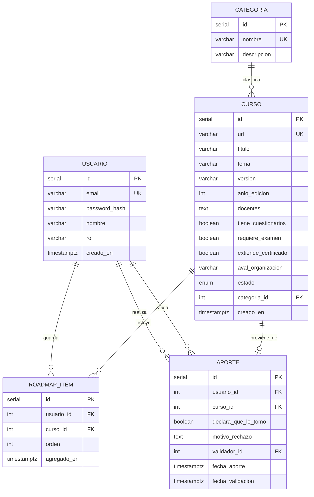
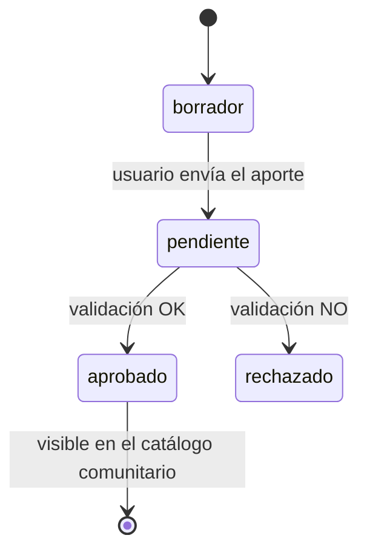

# BackendSchema — Esquema de base de datos y APIs — Learnity

## 1. Modelo de datos

### 1.1 Diagrama entidad-relación



### 1.2 Tablas

#### `usuarios`

| Columna | Tipo | Constraints | Notas |
|---------|------|-------------|-------|
| id | serial | PK | identificador unico de usuario |
| email | varchar(255) | UNIQUE NOT NULL | identificador de login |
| password_hash | varchar | NOT NULL | contraseña en bcrypt |
| nombre | varchar(100) | NOT NULL | nombre y apellido |
| rol | varchar(200) | NOT NULL, DEFAULT 'user' | valores permitidos: 'user', 'admin' |
| creado_en | timestamptz | NOT NULL, DEFAULT NOW() | fecha de registro

**Índices:** idx_usuarios_email en email para optimizar busqueda durante login.

#### `categorias`

| Columna | Tipo | Constraints | Notas |
|---------|------|-------------|-------|
| id | serial | PK | identificador unico de la categoria |
| nombre | varchar(100) | UNIQUE NOT NULL | nombre de rubro/area (lista cerrada) |
| descripcion | varchar(255) | NULL | Breve descripcion del area |


**Índices**: idx_categorias_nombre para ordenamiento y consultas directas

#### `cursos`

| Columna | Tipo | Constraints | Notas |
|---|---|---|---|
|  id | serial | PK | identificador unico del curso |
| url | varchar(2048) | NOT NULL, UNIQUE | enlace web activo del curso |
| titulo | varchar(200) | NOT NULL | titulo oficial del curso |
| tema | varchar(100) | NOT NULL | tematica o disciplina especifica |
| version | varchar(50) | NOT NULL | edicion o vesion del contenido |
| anio_edicion | integer | NOT NULL | año de publicacion |
| docentes | text | NOT NULL | nombre de docentes o instructores |
| tiene_cuestionarios | boolean | NOT NULL, DEFAULT false | flag de atributo |
| requiere_examen | boolean | NOT NULL, DEFAULT false | flag de atributo |
| extiende_certificado | boolean | NOT NULL, DEFAULT false | flag de atributo |
| aval_organizacion | varchar(150) | NULL | Nombre de la entidad que lo avala (opcional) |
| categoria_id | integer | FK → categorias, NOT NULL | lista cerrada |
| estado | enum_estado_curso | NOT NULL, default 'borrador' | ver [§2](#2-estados-del-ciclo-de-vida-del-curso) |
| creado_en | timestamptz | NOT NULL, DEFAULT NOW() | fecha de alta en el sistema |

**Índices**: idx_cursos_url (prevencion de duplicados); idx_cursos_cat_estado en (categoria_id, estado) para acelerar filtrado en catálogo.

#### `aportes`

| Columna | Tipo | Constraints | Notas |
|---|---|---|---|
| id | serial | PK | registro de la accion de aporte |
| usuario_id | integer | FK -> usuarios(id), NOT NULL | usuario autor del aporte |
| curso_id | integer | FK -> cursos(id), NOT NULL | referencia al curso creado | 
| declara_que_lo_tomo | boolean | NOT NULLL | declaracion obligatoria de si tomó o no el curso |
| motivo_rechazo | text | NULL | explicacion en caso de rechazar aporte |
| admin_id | integer | FK -> usuarios(id), NULL | moderador que ejecuta la validacion |
| fecha_aporte | timestamptz | NOT FULL, DEFAULT NOW() | marca temporal del envio |
| fecha_validacion | timestamptz | NULL | marca temporal de la revision |

**Índices**: idx_aportes_usuario en usuario_id e idx_aportes_curso en curso_id.

#### `roadmap_items`}

| Columna | Tipo | Constraints | Notas |
|---|---|---|---|
| id | serial | PK | registro de item guardado |
| usuario_id | integer | FK -> usuarios(id), NOT NULL | propietario del roadmap |
| curso_id | integer | FK -> cursos(id), NOT NULL | curso incluido |
| orden | integer | NOT NULL | posicion ordinal en el listado |
| agregado_en | timestamptz | NOT NULL, DEFAULT NOW() | fecha de incorporacion |

**Constraints**: UNIQUE(usuario_id, curso_id) para impedir dos veces el mismo curso en el roadmap personal.
**Índices**: idx_roadmap_usuario_orden en (usuario_id, orden) para recuperaar el roadmap del usuario ordenado.


## 2. Estados del ciclo de vida del curso



| Estado | Quién lo ve | Qué puede pasar |
|--------|-------------|-----------------|
| borrador | solo el autor | editar, enviar a revisión |
| pendiente | autor + admin | aceptar / rechazar |
| aprobado | todos | incluir en mi roadmap |
| rechazado | autor + admin | ver motivo |

## 3. API REST

**Convención general:**

- Prefijo: `/api/v1`
- Formato de datos: `application/json`
- Paginación: offset mediante `page` (default `1`) y `page_size` (default `20`).
- Errores:
 — `{ "error": { "code": "NOMBRE_DEL_CODIGO", "message": "Mensaje explicativo", "details": null } }`
- Timestamps en ISO 8601 UTC

### 3.1 Autenticación

| Método | Path | Auth | Request | Respuestas |
|--------|------|------|---------|------------|
| POST | `/api/v1/auth/registro` | pública | `{ "email": "...", "password": "...", "nombre": "..." }` | 201 `{…}` · 400 datos invalidos · 409 email duplicado · 422 validación |
| POST | `/api/v1/auth/login` | pública | `{ "email": "...", "password": "..." }` | 200 token/sesión · 401 credenciales · 429 rate limit |
| POST | `/api/v1/auth/logout` | sesión | — | 204 |

### 3.2 Catálogo de cursos

| Método | Path | Auth | Query / Request | Respuestas |
|--------|------|------|-----------------|------------|
| GET | `/api/v1/cursos` | pública | `page`, `page_size`, `categoria`, `q` | 200 paginado · 422 validacion |
| GET | `/api/v1/cursos/{id}` | pública | — | 200 · 404 no encontrado |

Ejemplo `GET /api/v1/cursos?page=1&page_size=2` → 200:

```json
{
  "items": [
    { "id": 1,
    "url": "...",
    "titulo": "Python desde cero",
    "tema": "Programación",
    "version": "v2.0",
    "anio_edicion": 2024,
    "docentes": "...",
    "tiene_cuestionarios": true,
    "requiere_examen": false,
    "extiende_certificado": true,
    "aval_organizacion": "UBA",
    "estado": "aprobado",
    "categoria": {"id": 3, "nombre": "Programación"},
    }
  ],
  "total": 47,
  "page": 1,
  "page_size": 2
}
```

### 3.3 Aportes de cursos y validación

| Método | Path | Auth | Request | Respuestas |
|--------|------|------|---------|------------|
| POST | `/api/v1/aportes` | sesión | { todos los campos del aporte + `declare_que_lo_tomo` } | 201 pendiente · 400 falta declaracion · 409 url duplicada · 422 validacion |
| GET | `/api/v1/aportes/{id}` | sesión (autor) | — | 200 · 403 no autorizado · 404 no encontrado |
| POST | `/api/v1/aportes/{id}/validar` | sesión (rol admin) | `{ "aprobado": true, "motivo_rechazo": null }` | 200 · 403 no es admin · 404 no encontrado |

### 3.4 Roadmap del usuario

| Método | Path | Auth | Request | Respuestas |
|--------|------|------|---------|------------|
| GET | `/api/v1/roadmap` | sesión | `page`, `page_size` | 200 paginado · 401 no autenticado |
| POST | `/api/v1/roadmap/items` | sesión | `{ "curso_id": 1, "orden": 1 }` | 201 · 409 ya incluido · 404 curso inexistente |
| DELETE | `/api/v1/roadmap/items/{id}` | sesión | — | 204 · 404 no encontrado |

### 3.5 Categorías (lista cerrada)

| Método | Path | Auth | Respuestas |
|--------|------|------|------------|
| GET | `/api/v1/categorias` | pública | 200 lista completa |

## 4. Decisiones del esquema

| Decisión | Alternativas | Por qué |
|----------|--------------|---------|
| Categorías como tabla independiente con FK | Postgres enum o campo varchar libre | Permite alimentar el endpoint `GET /api/v1/categorias` para selectores dinámicos de la UI y facilita modificar o agregar categorias |
| Roadmap como tabla intermedia con campo orden y restriccion UNIQUE(usuario_id, curso_id) | - | Mantiene la base de datos normalizada, permite hacer join direcyo con tabla cursos, facilita paginacion nativa en SQL |
| Atributos del curso como columnas booleanas explícitas | Un único campo de tipo JSONB | Simplifica las consultas y filtrados directos en SQL, garantiza tipado estricto, permite indexación directa si el volumen de datos crece |
| Estado del ciclo de vida del curso como tipo ENUM | Columna varchar con CHECK constraint o tabla FK de estados | Restringe los estados posibles a nivel de base de datos a los 4 definidos en la regla de negocio, optimiza el almacenamiento interno de Postgres y acelera las búsquedas por estado en el catálogo |
| Separación de la entidad aporte de la entidad curso | uardar los datos del aportante y moderador como columnas directas dentro de la tabla cursos | Separa la ficha del curso de su proceso de moderacion, conservando la declaracion de toma, historial de revision, marcas temporales y motivo de rechazo de forma limpia |

---

**Referencias:**
- Mermaid — Entity Relationship Diagrams: https://mermaid.js.org/syntax/entityRelationshipDiagram.html
- PostgreSQL — The Conceptual Model (tablas, constraints, índices): https://www.postgresql.org/docs/current/datamodel.html
