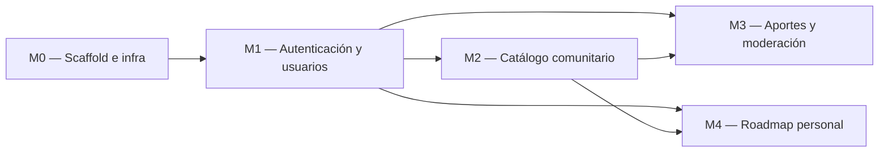

# Implementation Plan — Learnity

## 1. MVP — qué es P0

- US-001: Como visitante, quiero ver el catálogo comunitario paginado, para descubrir cursos sin registrarme
- US-002: Como visitante, quiero registrarme para acceder a las funcionalidades personales
- US-003: Como usuario registrado, quiero aportar un curso con sus metadatos, para enriquecer el catálogo
- US-004: Como usuario registrado quiero agregar cursos del catálogo a mi roadmap personal y gestionar su progreso para seguir el avance de mi aprendizaje

## 2. Módulos y dependencias

## 3. Detalle por módulo

### M0 — Scaffold e infraestructura

| # | Tarea | Hecho cuando… | Estimación |
|---|-------|----------------|------------|
| 0.1 | Estructura de carpetas del TRD §3.2 | el árbol existe en el repo, vacío pero correcto | 30 min |
| 0.2 | `docker-compose.yml` con postgres 18.6 | `docker compose up postgres` levanta y acepta conexiones | 45 min |
| 0.3 | Backend FastAPI mínimo con `GET /health` | `curl localhost:8000/health` responde 200 | 1 h |
| 0.4 | Frontend Vite + React 19 con shell (header + router) | `pnpm dev` muestra el shell navegable | 1 h |

### M1 — Autenticación

| # | Tarea | Hecho cuando… | Estimación |
|---|-------|----------------|------------|
| 1.1 | Modelo de datos `Usuario` y migración | Se crea la tabla `usuarios` en PostgreSQL con contraseña encriptada por bcrypt y campo `rol` | 1 h |
| 1.2 | Endpoint `POST /api/v1/auth/registro` | Permite registrar nuevos usuarios retornando HTTP 201; rechaza emails duplicados con HTTP 409 | 1.5 h |
| 1.3 | Endpoint `POST /api/v1/auth/login` con rate limit | Valida credenciales con bcrypt y retorna token/cookie HTTP 200; aplica rate limiting en reintentos | 2 h |
| 1.4 | Formularios UI de Autenticación `/login` y `/registro` | Permite iniciar sesión o registrarse desde la interfaz, guardando la sesión local del usuario | 2 h |
| 1.5 | Guard/Middleware de rutas protegidas en cliente | Intentar acceder a `/roadmap` o `/aportar` sin sesión activa redirige automáticamente a `/login` | 1 h |

### M2 — Catálogo comunitario

| # | Tarea | Hecho cuando… | Estimación |
|---|-------|----------------|------------|
| 2.1 | Seed de categorías y cursos de prueba | hay datos al levantar | 1h |
| 2.2 | Endpoint `GET /api/v1/categorias` | Retorna el listado completo de categorías disponibles con HTTP 200 | 45 min |
| 2.3 | Endpoint `GET /api/v1/cursos` paginado + filtros | Consulta paginada que permite filtrar por categoría y buscar por texto | 2 h |
| 2.4 | Endpoint `GET /api/v1/cursos/{id}` | Retorna los metadatos y atributos completos de un curso específico en estado `aprobado` | 1 h |
| 2.5. | Pantalla de catálogo con cards y paginador | Despliega grilla, selector de categorias, barra de busqueda y paginador | 2.5 h |
| 2.6 | Pantalla Detalle de curso | Muestra la ficha técnica con badges de atributos  y botón "Agregar a mi roadmap" | 1.5 h |

### M3 — Aportes y ciclo de validación

| # | Tarea | Hecho cuando… | Estimación |
|---|---|----|---|
| 3.1 | Modelos y tablas `cursos` y `aportes` | Se crean las tablas en la BD con enum de estados | 1 h |
| 3.2 | Endpoint `POST /api/v1/aportes` | Usuario autenticado envía curso con `declara_que_lo_tomo=true`; registra el aporte en `pendiente` | 2 h |
| 3.3 | Endpoint `GET /api/v1/aportes/{id}` | El autor del aporte consulta el estado de su envío y el motivo de rechazo (si aplica) | 1 h |
| 3.4 | Endpoints de moderación `GET` y `POST /validar` | Un usuario con rol admin puede consultar pendientes y aprobar o rechazar | 2.5 h |
| 3.5 | Pantalla Formulario de aporte | Formulario con validación inline de campos obligatorios, formato de URL y declaración de toma | 2.5 h |
| 3.6 | Pantalla Estado de mi aporte | Muestra el badge semántico de estado y el mensaje asociado | 1 h |
| 3.7 | Pantalla Panel de moderación | Muestra la lista de aportes pendientes con vista previa de metadatos y acciones de aprobación/rechazo | 2 h |

### M4 — Roadmap personal

| # | Tarea | Hecho cuando… | Estimación |
|---|---|----|---|
| 4.1 | Tabla `roadmap_items` con `UNIQUE(usuario_id, curso_id)` | Tabla intermedia creada con campo `orden` y restricción que impide agregar cursos repetidos | 1 h |
| 4.2 | Endpoint `GET /api/v1/roadmap` (paginado) | Retorna los cursos guardados por el usuario logueado en páginas de 20 elementos | 1.5 h |
| 4.3 | Endpoint `POST /api/v1/roadmap/items` | Agrega un curso publicado al roadmap con HTTP 201; retorna HTTP 409 si ya estaba incluido | 1 h |
| 4.4 | Endpoint `DELETE /api/v1/roadmap/items/{id}` | Elimina un ítem del roadmap del usuario y responde HTTP 204 | 45 min |
| 4.5 | Pantalla Mi roadmap | Despliega los cursos guardados del usuario, permite eliminarlos y navegar a sus detalles | 2 h |

## 4. Ejecución (Instancia B)

| # | Tarea | Módulo | Estado | Rama / Commit |
|---|-------|--------|--------|---------------|
| 0.1 | Estructura de carpetas + setup del workflow | M0 | [x] | feat/T1-scaffold-estructura |
| 0.2 | docker-compose postgres | M0 | [ ] | |
| 0.3 | backend minimo| M0 |[x] | feat/T2-backend-minimo |
| 0.4 | frontend minimo| M0 | [x] | feat/T3-frontend-minimo

## 5. Estrategia de testing

> Se **planificá** acá y se **implementa** en la clase del 27/10.

- **Unit tests (services):** funciones puras de negocio con Patrón AAA, sin BD ni HTTP.
  - Reglas de validación en el formulario de aportes (declaración obligatoria de toma, formato de URL).
  - Reglas de unicidad del roadmap personal (impedir agregar cursos duplicados).
  - Transiciones de estado del ciclo de vida del curso.
- **Integration tests (repositories/services):** contra BD real PostgreSQL.
  - Endpoints de API REST (códigos de respuesta HTTP y estructura unificada de errores).
  - Restricciones SQL (`UNIQUE`, llaves foráneas, paginación con offset)
- **Frontend:** hooks con Vitest.
  - Hooks de estado de carga, renderizado de skeletons y empty states
  - Comportamiento del paginador y cambio de páginas en catálogo y roadmap
- Objetivo de cobertura: ≥ 80% de cobertura en servicios de backend y componentes principales del frontend

## 6. Riesgos del plan

| Riesgo | Impacto | Mitigación |
|--------|---------|------------|
| Validación de URLs de cursos externos más compleja de lo previsto | Medio | Utilizar esquemas estrictos restringiendo la verificación inicial a formato URL válido y detección de duplicados en base de datos. |
| Retrasos en el maquetado mobile-first sin librerías externas | Medio | Reutilizar la escala de design tokens y componentes predefinidos en [UX-UI.md](./UX-UI.md), probando la visualización en 360px desde el inicio |
| Sincronización de estado entre agregados al catálogo y la vista del roadmap | Bajo | Implementar invalidación de consultas en el cliente y notificaciones Toast inmediatas tras recibir la respuesta HTTP 201 |

---

**Referencias:**
- Atlassian — Plantilla de plan de proyecto: https://www.atlassian.com/software/confluence/templates/project-plan
- Shape Up — cómo partir trabajo real en scopes cerrables: https://basecamp.com/shapeup/
